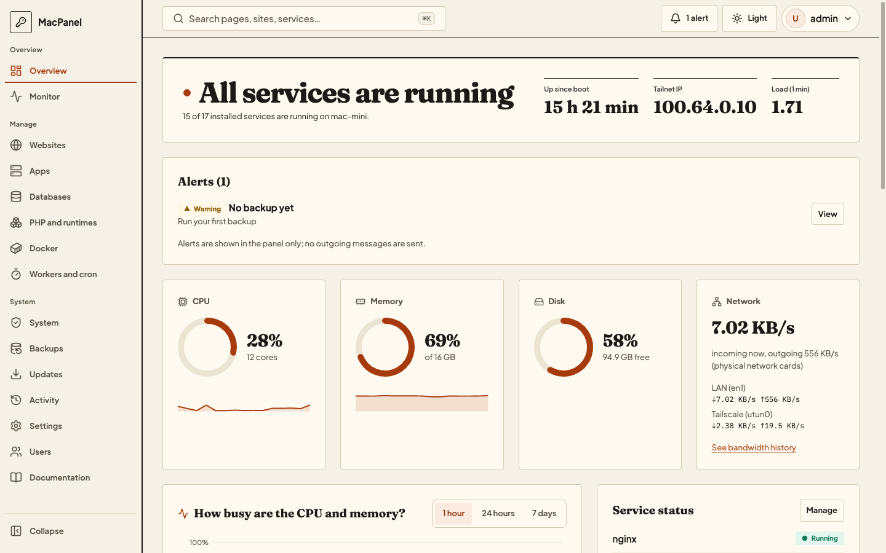
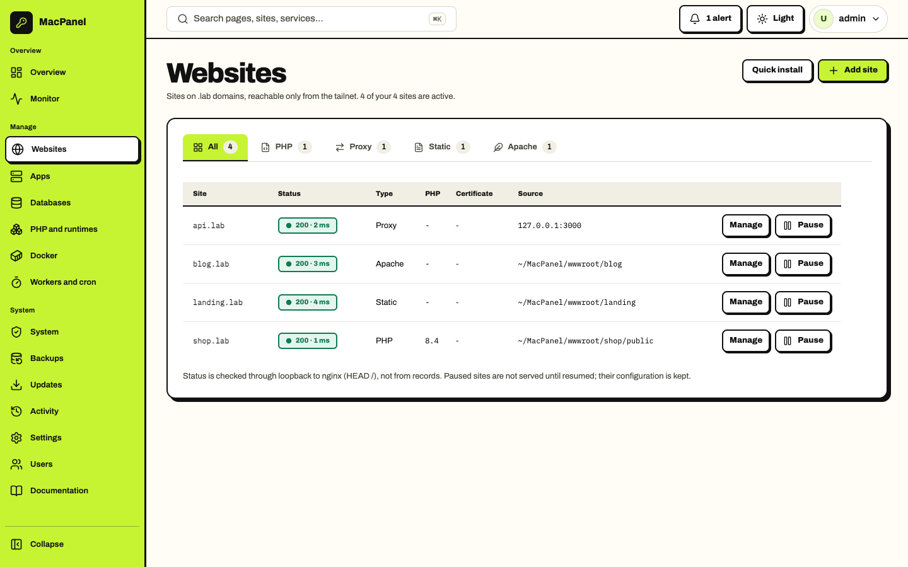
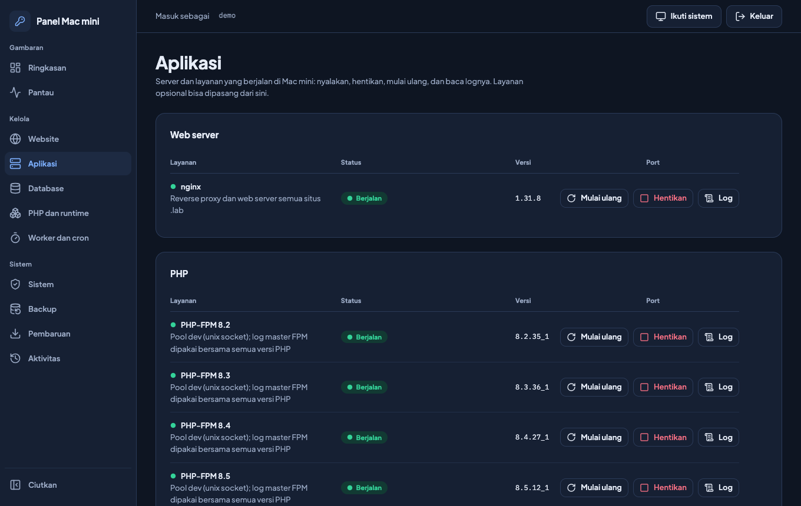
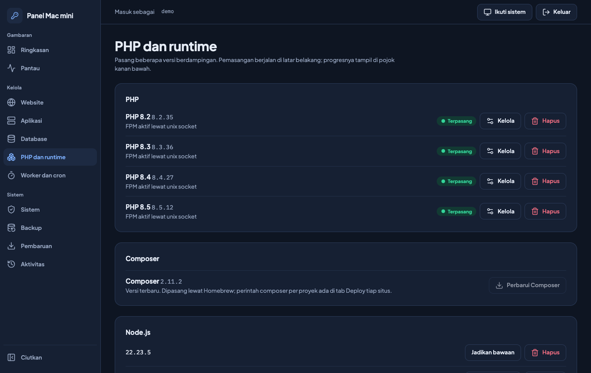
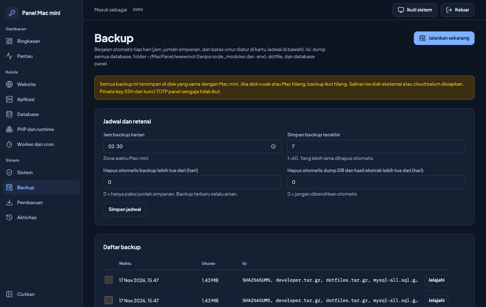
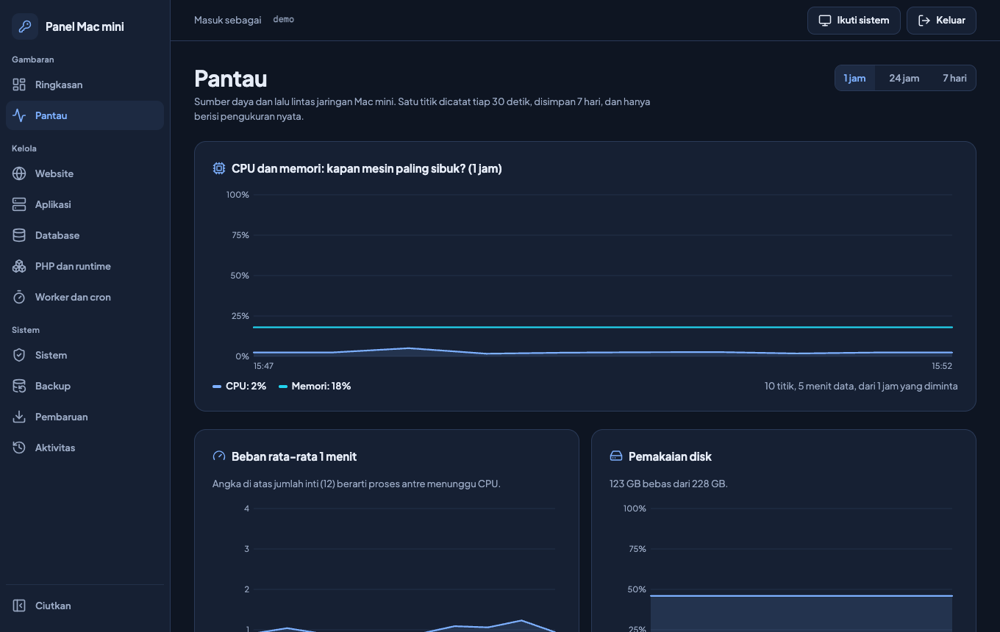

# MacPanel

**A self-hosted web control panel for macOS: the aaPanel / cPanel experience for a Mac mini or MacBook dev server.**

Manage websites (nginx), multiple PHP versions and extensions, MariaDB/MySQL/PostgreSQL databases, Node/Go/Python runtimes, workers and cron (launchd), deploys, backups and monitoring from one browser UI, protected by password + TOTP and meant to be reachable only over a private network (e.g. Tailscale).

> Status: 0.1, used daily on one Mac mini (macOS, Apple Silicon). macOS only. See "Install" and "Known gaps", and [CHANGELOG.md](CHANGELOG.md).

Keywords: macOS server panel, Mac mini home server, nginx panel for Mac, aaPanel alternative for macOS, cPanel alternative macOS, Homebrew PHP-FPM manager, launchd GUI, self-hosted dev server panel.

## Screenshots

Captured from a throwaway demo instance (fake sites, empty database list, no real hostnames or IPs).

| | |
|---|---|
|  |  |
|  |  |
|  |  |

## Features
- **Websites:** add/remove/pause sites (PHP, static, reverse proxy), per-site PHP version, rewrite/redirect rules, nginx config editor with version history and automatic rollback on `nginx -t` failure, local HTTPS (mkcert), logs, HTTP health + certificate expiry.
- **PHP:** install 8.2-8.5 side by side, PECL extensions with on/off switches (redis, apcu, xdebug, imagick, igbinary, msgpack, pcov, yaml, memcached, mongodb), FPM pool settings, restart + logs, Composer.
- **Databases:** MariaDB (3306), MySQL (3307) and PostgreSQL create / dump / restore / upload dump (restore refuses dangerous client commands and runs as the project user).
- **Runtimes:** Node, Go, Python, pnpm via mise.
- **Apache (optional):** per-site `.htaccess` support. Apache listens on `127.0.0.1:8080` only, behind nginx, so TLS and the private-network restriction stay in one place.
- **Workers and cron:** supervisor/crontab equivalent on launchd. Task types Shell, PHP, Node, Python and URL; schedules from every N minutes to a full 5-field cron and `@reboot`.
- **Deploy:** per-site git pull, composer, npm/pnpm, artisan, FPM restart.
- **Monitoring:** CPU, memory, disk, load, per-interface bandwidth with 7-day history; alerts for disk, memory, services, site errors, SSL expiry, stale backups.
- **Security:** loopback bind, TOTP at login, password step-up for destructive actions, hash-chained audit log, admin/viewer roles, no web shell.
- **App projects and Docker:** one-click Go, Python, and Next.js projects (launchd worker on loopback + nginx proxy site), optional Docker via Colima with container/image/Compose management and a Compose security policy (no privileged, host network, extra capabilities, devices, or mounts outside wwwroot).
- **Accounts and databases:** panel user management (temporary password, forced change on first login), extra database users per database (read-only / read-write / full, localhost only), root password rotation with verification and rollback.
- **Settings and automation:** panel name and theme, password change, 2FA on/off per account, trusted devices, and scoped API tokens (read / operate / full) with a `panelctl` CLI so scripts and AI agents can drive the panel. Credentials, `.env` contents and login/2FA never go through a token.
- **Housekeeping:** disk and memory cleanup with a three-level catalog (`lab clean`, `lab mem`), staged uninstall (`lab uninstall`), read-only Tailscale status, exposure checker.
- **Interface:** React + Vite. Four visual styles with light/dark and accent colour, global search (Ctrl K), profile menu (avatar or photo, password, 2FA, language), Indonesian and English, skeleton loading, responsive to 320 px, accessible (keyboard, 44px targets, reduced motion). Backend: one Go binary with SQLite.

## How it is built
```
browser -> nginx (TLS, private-network only) -> panel (Go, 127.0.0.1:9100)
                                                   |
                                                   v   fixed subcommands, validated args, no shell
                                                  lab  (cli/: Python wrappers around brew, nginx, launchd, mise, mysql, psql)
```
- `cmd/panel`, `internal/` the Go panel (one package per domain, see `docs/architecture/`). `ui/` the React UI. `cli/` the `lab` command. `nginx/` reference config. `docs/` design, usage, architecture decisions.
- Docs: [docs/DESIGN.md](docs/DESIGN.md) (threat model), [docs/USAGE.md](docs/USAGE.md) (user guide, Indonesian; source in `docs/guide/`, also shown inside the panel), [CONTRIBUTING.md](CONTRIBUTING.md), [SECURITY.md](SECURITY.md).

## Install
Requirements: macOS (Apple Silicon), [Homebrew](https://brew.sh), and a private network such as [Tailscale](https://tailscale.com).

```sh
git clone https://github.com/roqianjas/macpanel ~/MacPanel/server/panel
cd ~/MacPanel/server/panel
./install.sh --dry-run     # show the plan, change nothing
./install.sh               # asks for confirmation (use --yes to skip)
```
The installer installs missing Homebrew packages (nginx, mkcert, dnsmasq, go, node, pnpm, sqlite), lays out `~/MacPanel/server`, copies the user guide, builds the UI and the Go binary, creates the Keychain key and the `panel` LaunchAgent (127.0.0.1:9100), and adds `https://panel.lab` to nginx. It never uses `sudo` or asks for passwords. At the end it offers to create the admin account (you type the password and scan the TOTP key; the script never sees them) and prints the steps you do yourself, such as DNS for `*.lab` (needs `sudo`).
Options: `--no-brew`, `--no-system` (skip anything outside your home folder and the build), `--tld NAME`. It will not overwrite a customised nginx.conf (prints one `include` line to add instead).

Tested: a clean copy of this repo installed into an empty HOME (`--no-brew --no-system`): UI built from scratch, Go binary built, layout correct, re-run is a no-op. Not tested: the system steps on a fresh Mac (mkcert, LaunchAgent, nginx link), since the author's machine already has them.

## Known gaps
- macOS on Apple Silicon with Homebrew only; no Linux support. The `~/MacPanel/server` layout is fixed (the installer creates it).
- Translation is partial: the interface shell and the most-used pages are Indonesian and English, other pages and all server-produced text (alert titles, service descriptions, error messages) are Indonesian only. The in-panel user guide is Indonesian.
- Backups are local; no offsite upload. Local HTTPS uses mkcert; no ACME. Alerts: in panel and optional ntfy push; no email, Telegram or webhook.
- macOS Homebrew PHP compiles bundled extensions statically, so only PECL extensions can be toggled.
- No file manager and no web terminal, by design. Anything needing `sudo` is shown as a command for you to run.
- The system steps of the installer are verified on the author's machine, not yet on a freshly provisioned Mac.

## Contributing
Issues and PRs welcome. See [CONTRIBUTING.md](CONTRIBUTING.md); `make check` is the gate.

## License
MIT
